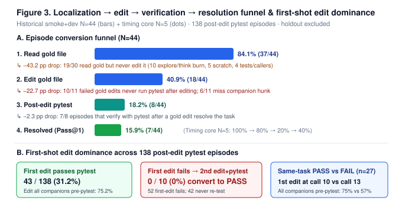

# SWE-HorizonBench

**Official companion toolkit** for the paper:

> **From Local Validation to Live Evaluation**  
> *How Broken Tests, LoRA Serving Overhead, and Context Limits Bottleneck 4-Bit Coding Agents*

**Authors:** Moran Zavdi (team)  
**Resources:** [GitHub](https://github.com/Aeterna-Data-AI-ML-Research/swe-horizon-bench) · Kaggle dataset [`moranzavdi/gemma4-soundness-and-punica-bench`](https://www.kaggle.com/datasets/moranzavdi/gemma4-soundness-and-punica-bench) · notebook [`moranzavdi/from-local-validation-to-live-evaluation`](https://www.kaggle.com/code/moranzavdi/from-local-validation-to-live-evaluation)

This repository releases the reusable diagnostics from that study as a **zero-runtime-dependency**, `pip`-installable Python package: two-sided harness soundness, **AST-HorizonGraph** localization under a 150-line read horizon, **MS-SFT** serve-cost-aware trajectory selection, the **SWE-HorizonBench-OOD** probe (60 tasks / 8 external libraries), and a native `@kbench.task` verification suite.

---

## Overview

Autonomous coding agents often look strong on small local smoke tests yet fail under live evaluation with a fixed wall-clock budget. The paper shows that end-to-end Pass@1 under 4-bit Gemma 4 serving is governed not by weights alone, but by coupled system bottlenecks. This toolkit implements the open reproducibility surface described in §6.3 of the paper:

| Component | What it does | Paper section |
| --- | --- | --- |
| `soundness_gate` | Two-sided empty/oracle usability; patch topology (S1/S2/S3) and hunk-tier (F1/F2/F3) | §3, §5.3 |
| `ASTHorizonGraph` | IDF-seeded symbol graph with import / call / sibling / attribute edges; ranks ≤150-line windows | §6.1 |
| `ms_sft_selector` | Minimal-Sufficient SFT scoring \(\mathcal{J}_{\mathrm{MS}}\) and per-task winner selection | §6.2 |
| `SWE-HorizonBench-OOD` | 60 synthetic localization targets, 0% overlap with competition `{fastapi, rich, requests, httpx}` | §6.3 |
| `@kbench.task` suite | Offline/live checks for localization, inline-repro policy, and Punica budget feasibility | §6.3 |

**Construct-validity note (important).** Synthetic OOD prompts that name target symbols inflate lexical/graph recall the same way seeded gold-file pools do (§6.1). Treat OOD as a fast CPU sanity check and construct-validity baseline—not as evidence for end-to-end unseeded retrieval claims.

---

## Headline results (from the paper)

These figures are measured on the competition host / audited trajectories; the toolkit lets you reproduce the *methods* and the OOD probe locally (no GPU required).

| Finding | Result |
| --- | ---: |
| Two-sided soundness (129 public tasks) | **111** usable before dep repair; **116** after (**85** usable non-holdout) |
| Localization → resolution funnel (N=44) | Gold-file read **84.1%** → resolve **15.9%** |
| Second-edit recovery after failed first edit | **0 / 10** |
| Unmerged rank-64 LoRA (N=5 uncapped pairs) | Pass@1 unchanged **0.40**, episode throughput **20.09 → 11.01** tok/s |
| Paired wall delta (N=15 / 10 tasks) | **+90.5 s** / task (task-clustered *p* = 0.006) |
| MS-SFT vs random passer (projected 120-task LoRA @11.01 tok/s) | **14.10 h → 11.86 h** (under 12 h) |
| Full-repo file recall @K=3 (46 multi-hunk/multi-file tasks) | Dense AST chunks **0.51** vs AST-HorizonGraph **0.22** |
| OOD two-sided sample | **11 / 11** usable |

<p align="center">
  
</p>

<p align="center"><em>Figure 3 (paper): post-localization funnel — 84.1% gold read → 15.9% resolved.</em></p>

---

## Installation

**Requirements:** Python ≥ 3.10. Runtime dependencies: none beyond the standard library (`ast`, `json`, `math`, `pathlib`, `re`, …). Optional: `pytest` (dev), `pandas` (DataFrame convenience), `kaggle_benchmarks` (live Kaggle Benchmarks SDK).

```bash
# from source (recommended)
git clone https://github.com/Aeterna-Data-AI-ML-Research/swe-horizon-bench.git
cd swe-horizon-bench
python3 -m venv .venv && source .venv/bin/activate
pip install -e ".[dev]"

# or directly from GitHub
pip install "git+https://github.com/Aeterna-Data-AI-ML-Research/swe-horizon-bench.git"
```

Verify:

```bash
pytest tests/ -q
# expected: 7 passed
```

---

## Quickstart

### Localize under a 150-line horizon (any Python repo)

```bash
python3 -m swe_horizon_bench.cli localize \
  --repo /path/to/your/python/project \
  --query "AsyncClient timeout ignored when follow_redirects=False" \
  --seed src/client.py \
  -k 3
```

Returns up to `K` coupling-ranked **≤150-line** read windows from a 1-hop import / call / sibling / attribute AST graph with sub-token IDF weighting.

### Python API

```python
from swe_horizon_bench import (
    localize_windows,
    j_ms,
    select_ms_sft,
    classify_topology,
    two_sided_sound,
)

# 1) Rank read windows for an issue
wins = localize_windows(
    "~/code/myrepo",
    "pluggy hook wrapper order",
    seed_file="src/pluggy/_hooks.py",
    k=3,
)

# 2) Two-sided soundness gate (empty must fail; oracle must pass)
gate = two_sided_sound(empty_pass=False, oracle_pass=True, candidate_pass=True)
assert gate["usable"] and gate["candidate_sound_solve"]

# 3) Oracle patch topology under the 150-line horizon law
topo = classify_topology(open("gold.patch").read())
# -> topology in {S1_single_hunk, S2_single_file_multi_hunk, S3_multi_file}
#    hunk_tier in {F1, F2, F3}, any_file_delta_L_gt_150: bool

# 4) MS-SFT: pick one serve-cost-optimal winner per solved task
winner = select_ms_sft([
    {"task_id": "t1", "sound": True, "tokens": 3918, "steps": 24,
     "hunks": 2, "gold_hunks": 3, "scratch": False},
    {"task_id": "t1", "sound": True, "tokens": 6200, "steps": 40,
     "hunks": 5, "gold_hunks": 3, "scratch": True},
])["t1"]
assert winner["j_ms"] == j_ms(
    True, 3918, 24, 2, 3, False,
    alpha=1.5, beta=1.0, gamma=0.5, delta=2.0,
)
```

### OOD probe and kbench suite

```bash
# Summarize / echo precomputed OOD eval
python3 -m swe_horizon_bench.cli evaluate-ood \
  --dataset data/swe_horizon_bench_ood_60.jsonl

# Run the 3-task native @kbench.task suite (offline shim or live SDK)
python3 -m swe_horizon_bench.cli kbench-suite \
  --dataset data/swe_horizon_bench_ood_60.jsonl \
  --out data/swe_horizon_bench_kbench_leaderboard.json
```

```python
from swe_horizon_bench import load_ood_dataframe, run_kbench_suite, TASK_NAMES

df = load_ood_dataframe("data/swe_horizon_bench_ood_60.jsonl")  # 60 rows
board = run_kbench_suite(df=df)
print(TASK_NAMES)
# ('swe_horizon_b1_vs_ast_localization',
#  'swe_horizon_w2_inline_repro_guard',
#  'swe_horizon_punica_budget_feasibility')
```

---

## Method cards

### 1. Two-sided soundness (`soundness_gate`)

A task is **usable** iff:

1. **Empty-patch check** — tests fail on the unmodified repo (no false solves).
2. **Reference-fix check** — tests pass with the human oracle patch applied.

```python
from swe_horizon_bench import two_sided_sound, classify_topology

two_sided_sound(empty_pass=False, oracle_pass=True)  # usable
classify_topology(patch_text)  # S1 / S2 / S3 + ΔL > 150 flag
```

Paper census (Table 1): **111 / 129** usable before dependency repair; pinning `starlette==0.46.2` + `PYTHONPATH=src` recovers **5** further tasks (**18 → 13** unusable).

### 2. AST-HorizonGraph (`ast_horizon_graph`)

Builds \(G = (V, E_{\mathrm{import}} \cup E_{\mathrm{call}} \cup E_{\mathrm{sibling}} \cup E_{\mathrm{attr}})\) over Python sources, ranks issue tokens by sub-token IDF, and allocates **K** disjoint ≤150-line windows. Design choices matched to the paper:

- **Header bridge at K=1** when a deep seed is not decisive vs. the file header (common deep-S2 gold).
- **Attribute coupling** (`self.<attr>`) to surface distant same-file companions at K≥2.
- **Sequential fill** on the seed file so the reader never trails pure pagination on the entry path.

On the paper’s **46** multi-hunk / multi-file tasks (Table 4), seeded AST-HorizonGraph **ties BM25** and **trails dense AST-chunk file discovery** on the full repo (**0.22** vs **0.51** file recall @K=3)—a documented negative result, not a marketing claim.

### 3. MS-SFT (`ms_sft_selector`)

Serve-cost-aware trajectory curation (a selection rule, not a training loss):

\[
\mathcal{J}_{\mathrm{MS}}(\tau)=\mathbb{I}[\mathrm{SoundPass}(\tau)]\cdot
\exp\!\Big(-\alpha\tfrac{\mathrm{Tokens}}{T_{\max}}
-\beta\tfrac{\mathrm{Steps}}{N_{\max}}
-\gamma\tfrac{\mathrm{Hunks}}{\mathrm{Hunks}_{\mathrm{gold}}}
-\delta\,\mathbb{I}[\mathrm{Scratch}]\Big)
\]

Default weights \((\alpha,\beta,\gamma,\delta)=(1.5,1.0,0.5,2.0)\), \(T_{\max}=8192\), \(N_{\max}=80\). Keep exactly one \(\tau^*_t = \arg\max \mathcal{J}_{\mathrm{MS}}\) per solved task.

| Selection rule (Table 5) | Mean tokens | Projected 120-task LoRA hours @4096 |
| --- | ---: | ---: |
| Uniform random passer | 4658 | **14.10 h** |
| Closest to full human gold PR | 4970 | **15.05 h** |
| Fewest agent steps | 4195 | 12.70 h |
| **MS-SFT** | **3918** | **11.86 h** |

Projections use the measured unmerged LoRA episode rate **11.01 tok/s** (§5.2).

### 4. SWE-HorizonBench-OOD

| Property | Value |
| --- | --- |
| Tasks | **60** |
| Libraries | `starlette`, `click`, `typer`, `urllib3`, `packaging`, `pluggy`, `anyio`, `httpcore` |
| Competition overlap | **0%** vs `{fastapi, rich, requests, httpx}` |
| Stratification (diff-classified) | S1 **18** (8 ≤150 / 10 >150), S2 **22** (11 / 11), S3 **20** |
| Marker protocol | `# HORIZON_BENCH_FIX` on real `def` lines; grade marker placement |
| Two-sided sample | **11 / 11** usable |

Shipped eval artifact: [`data/swe_horizon_bench_ood_eval.json`](data/swe_horizon_bench_ood_eval.json) (AST vs B1 header vs sequential pagination by stratum).

### 5. Native `@kbench.task` suite

| Task | Checks |
| --- | --- |
| `swe_horizon_b1_vs_ast_localization` | AST-HorizonGraph cover ≥ B1 (first-150) on OOD |
| `swe_horizon_w2_inline_repro_guard` | Inline reproduction policy on tasks that need it |
| `swe_horizon_punica_budget_feasibility` | MS-SFT projected wall under LoRA rate stays < 12 h vs verbose passers |

Runs with the live `kaggle_benchmarks` SDK when installed; otherwise uses a deterministic offline shim (CI / notebook).

---

## Repository layout

```text
swe-horizon-bench/
├── LICENSE                          Apache-2.0
├── README.md                        this file
├── pyproject.toml                   package metadata (v0.1.1)
├── dataset-metadata.json            Kaggle dataset descriptor
├── src/swe_horizon_bench/
│   ├── ast_horizon_graph.py         AST-HorizonGraph + localize_windows
│   ├── ms_sft_selector.py           J_MS, select_ms_sft, summarize_policies
│   ├── soundness_gate.py            two_sided_sound, classify_topology
│   ├── kbench_tasks.py              @kbench.task suite + offline shim
│   ├── cli.py                       localize | evaluate-ood | kbench-suite
│   └── __main__.py                  python -m swe_horizon_bench
├── data/
│   ├── swe_horizon_bench_ood_60.jsonl
│   ├── swe_horizon_bench_ood_eval.json
│   ├── swe_horizon_bench_kbench_leaderboard.json
│   ├── task_soundness_129_aggregate.json
│   ├── task_soundness_non_holdout.csv
│   ├── table_1b_harness_pin_flips.json
│   ├── p627_*.json … p708_*.json    paper claim-group artifacts
│   └── paper-draft-nov12.md         local manuscript draft snapshot
├── notebooks/
│   ├── swe_horizon_bench_paper_reproduction.ipynb
│   └── figures/                     fig1–fig5 SVG + summary PNG
└── tests/
    └── test_swe_horizon_bench.py
```

---

## Reproducing paper-facing checks

No GPU, model weights, or network access are required for the toolkit path.

```bash
# Unit tests (API contracts, deep-S2 header bridge, offline kbench suite)
pytest tests/ -q

# OOD kbench leaderboard (writes JSON)
python3 -m swe_horizon_bench.cli kbench-suite

# Interactive: open the reproduction notebook
jupyter notebook notebooks/swe_horizon_bench_paper_reproduction.ipynb
```

**What this repo can verify.** Toolkit APIs, OOD JSONL integrity (n=60, 0% competition overlap), precomputed OOD recall tables, kbench suite pass/fail, and the claim-group JSON artifacts under `data/`.

**What requires the companion paper dataset / notebook.** Full recomputation of all quantitative paper claims (soundness census rows, paired LoRA Wilcoxon / bootstrap CIs, nine-reader Table 4, MS-SFT corpus macros over 1,237 trajectories). Prefer the paper track bundle (`moranzavdi/gemma4-soundness-and-punica-bench`) for that audit.

**Holdout safety.** The sealed 31-task author holdout is excluded from diagnostics, reader design, and adapter training. Do not add holdout task IDs to this repository.

---

## Retrieval reference table (paper Table 4 excerpt)

46 sound non-holdout multi-hunk / multi-file tasks; K disjoint ≤150-line windows; issue text only.

| Retrieval strategy | Seeded gold files @3 / @5 | Unseeded full repo @3 / @5 | Repo file recall @3 |
| --- | :---: | :---: | :---: |
| Top-150 (headers) | 0.36 / 0.37 | 0.11 / 0.15 | 0.38 |
| Sequential pages | 0.39 / 0.45 | 0.10 / 0.13 | 0.17 |
| BM25 windows | **0.55** / 0.65 | 0.19 / 0.28 | 0.40 |
| Dense AST chunks (Jina-code) | 0.48 / 0.59 | **0.27 / 0.36** | **0.51** |
| AST-HorizonGraph (IDF) | 0.54 / **0.69** | 0.13 / 0.18 | 0.22 |
| Oracle window placement | 0.87 / 0.92 | 0.87 / 0.92 | 0.84 |

Full per-reader matrices: [`data/p707_horizongraph_baseline_suite.json`](data/p707_horizongraph_baseline_suite.json).

---

## Citation

If you use this toolkit, the OOD probe, or the diagnostics, please cite the paper:

```bibtex
@article{zavdi2026localtove,
  title   = {From Local Validation to Live Evaluation:
             How Broken Tests, LoRA Serving Overhead, and Context Limits
             Bottleneck 4-Bit Coding Agents},
  author  = {Zavdi, Moran},
  year    = {2026},
  note    = {Gemma 4 Developer Agent Paper Track;
             toolkit: https://github.com/Aeterna-Data-AI-ML-Research/swe-horizon-bench},
  url     = {https://www.kaggle.com/competitions/gemma-4-developer-agent-paper}
}
```

Also cite this software release when the code itself is a contribution:

```bibtex
@software{swehorizonbench2026,
  title  = {{SWE-HorizonBench}: AST-HorizonGraph, MS-SFT, and OOD diagnostics
            for coding agents under a read-file horizon},
  author = {Zavdi, Moran},
  year   = {2026},
  url    = {https://github.com/Aeterna-Data-AI-ML-Research/swe-horizon-bench},
  version = {0.1.1},
  license = {Apache-2.0}
}
```

---

## Limitations

- **OOD is synthetic.** Prompts that name symbols overstate lexical/graph recall; use natural unseeded issues for end-to-end retrieval claims (§6.1, §6.3).
- **Paired serving N is small.** Uncapped timing core N=5; expanded cohort N=15 over 10 tasks with right-censoring at 480 s (§5.2).
- **Single-draw leaderboard scores.** Gaps ≤0.01 are within episode noise (~one solved task).
- **Host-specific horizon.** The 150-line / 10k-char `read_file` cap and W4A16 Punica path are properties of the competition stack; transfer to other harnesses needs re-measurement.
- **Graph ≠ file discovery.** AST-HorizonGraph’s seeded gain is largely lexical (ties BM25); dense chunk retrieval leads on unseeded file recall.

---

## License

Apache License 2.0 — see [`LICENSE`](LICENSE).

All source in this repository is released under Apache-2.0. Dataset artifacts under `data/` accompany the paper for reproducibility; if you redistribute derived corpora, preserve attribution and the two-sided soundness definition above.

---

## Disclaimer

This is **not** an official Google product. It is an independent research release associated with the Kaggle Gemma 4 Developer Agent paper track. Competition leaderboard scores and host behavior are as observed by the authors; they may change if the evaluation stack is updated.
