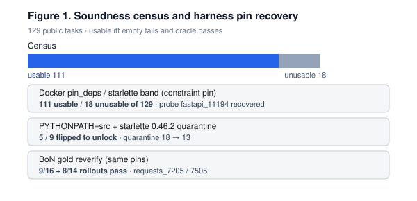
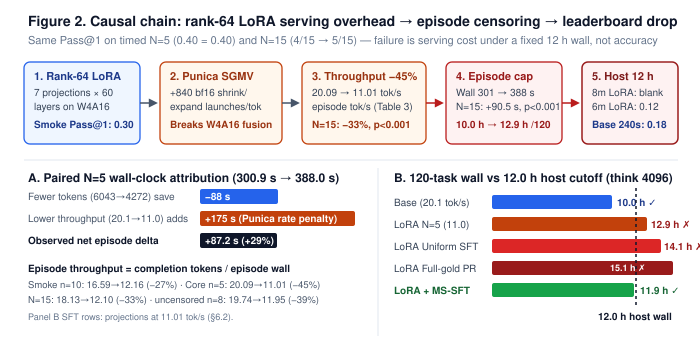
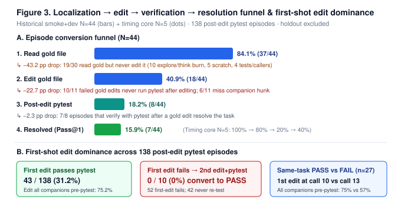
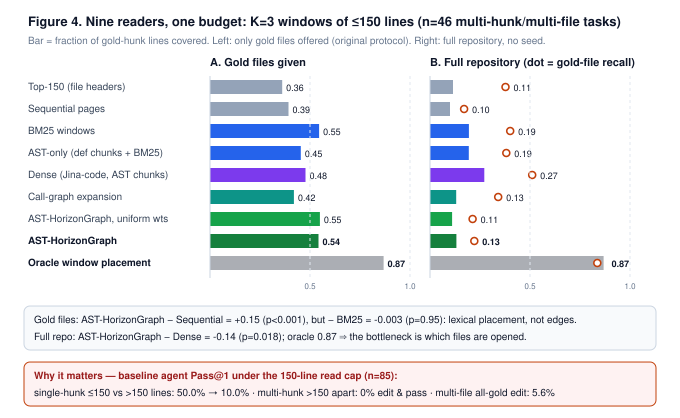
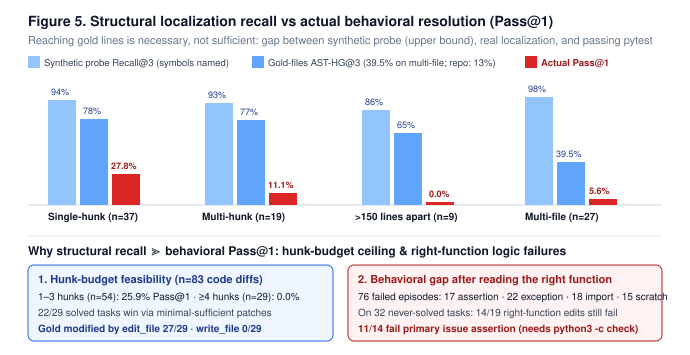

# From Local Validation to Live Evaluation

### How Broken Tests, LoRA Serving Overhead, and Context Limits Bottleneck 4-Bit Coding Agents

**Authors:** Moran Zavdi (team) · **Resources:** dataset `moranzavdi/gemma4-soundness-and-punica-bench` · notebook `moranzavdi/from-local-validation-to-live-evaluation`.

## Abstract

Autonomous coding agents often achieve strong results on small local test sets yet fail under live competition evaluation, where a strict 12-hour runtime limit governs the full benchmark. Compounding this gap, local evaluation is itself distorted by flawed benchmark tests that pass without code changes or fail even on the human developer's reference fix. To explain why local gains fail to transfer to live evaluation, we audit 129 public tasks and 1,237 agent trajectories across 4-bit quantized Gemma 4 models (31B and 4B), demonstrating that end-to-end bug resolution (Pass@1) is governed not by model weights alone, but by four system-level bottlenecks:

1. **Test-suite integrity:** Enforcing two-sided test validation—requiring tests to fail before patching and pass on the reference fix—identifies **111** of 129 tasks as sound before environment dependency repair, increasing to **116** after dependency repair (leaving **13** tasks with broken reference tests or empty-patch passes).
2. **LoRA serving overhead:** In the competition's vLLM W4A16 serving stack, unmerged rank-64 LoRA adapters leave the fused 4-bit kernel path. Across **5** paired timing-core runs where neither arm hit the 480 s task cap (N = 5), LoRA leaves accuracy unchanged at **0.40** Pass@1 while cutting episode throughput from **20.1 to 11.0** tok/s (a **10.0 to 12.9 h** projected 120-task runtime); across all N = 15 paired runs, LoRA adds **+90.5 s** per task (*p* = 0.006), and an 8 min/task rank-64 submission timed out at the 12-hour competition limit.
3. **File-reading context limits & single-attempt editing:** Across the same 44 audited runs, agents read at least one target file from the reference patch in **84.1%** of runs (**37/44**) yet resolve only **15.9%** (**7/44**): a 150-line `read_file` cap conceals companion edit sites, and in the **10** observed cases where an agent attempted a second edit after its first patch failed unit tests, **0/10** achieved a passing repair.

To address these bottlenecks, we pair dense AST-chunk retrieval—which more than doubles repository-wide target-file discovery over graph traversal (**51% vs. 22%** at K = 3)—with serve-cost-aware trajectory selection (**MS-SFT**), cutting projected 120-task LoRA runtime below the 12-hour limit (**14.10 to 11.86 h**, and **5.72–7.03 h** under folded rank-8 adapters). Finally, while naive and stub-anchored 31B rank-8 adapters (**0.12** and **0.17**) still trail calibrated base inference (**0.18** with a 240 s command timeout) due to prompt-prefix skew and premature-submission drift, our attention-frozen (Δq = Δo = 0) right-subspace projection eliminates submission drift, lifts teacher-forced code-edit preference from **45.5% to 63.6%** (**14/22**), and doubles live 4B leaderboard resolution from **0.03 to 0.06**.

## 1. Introduction

Why do autonomous coding agents that achieve high first-attempt resolution rates (Pass@1) on small local test sets stall when deployed to the live competition evaluation server? In the Gemma 4 Developer Agent competition, agents must resolve real-world Python bugs across **FastAPI**, **httpx**, **Requests**, and **Rich** under a strict **12-hour total runtime limit** (where each resolved public task contributes roughly **0.017** to the leaderboard score). Although prior work has examined benchmark contamination, repository retrieval, and parameter-efficient fine-tuning separately, their combined interaction under a fixed end-to-end quantized execution budget remains under-characterized. Using the competition's 4-bit quantized models (`gemma-4-31b-it-qat-w4a16-ct` and `gemma-4-e4b-it-qat-w4a16-ct`), we demonstrate that live evaluation performance is governed not by model weights alone, but by four coupled system bottlenecks:

* **Benchmark test-suite soundness (§3):** Broken unit tests and environment dependency mismatches that corrupt local Pass@1 signals.
* **LoRA serving overhead (§§4–5.2):** In the competition's vLLM W4A16 serving stack, unmerged low-rank adapters exit the fused 4-bit GPU kernel path under Punica at `batch_size=1`, cutting token throughput by 27%–45%.
* **The 150-line file-reading horizon (§§5.3, 6.1):** Tool output truncation (`read_file` capped at 150 lines) that conceals companion edit locations even after the agent opens the correct target file.
* **Single-attempt editing fragility & fine-tuning skew (§§5.3, 6.2–6.4, 9):** Among **10** observed episodes in which an agent attempted a second edit after its first patch failed unit tests, **0/10** produced a passing repair—a bottleneck compounded during naive low-rank adaptation by training-inference prompt-prefix mismatch and premature-submission logit drift.

We organize our investigation into three primary contributions:

1. **System Diagnosis (§§3–5, §7):** A two-sided soundness audit of all **129** public tasks, paired right-censored serving measurements, a post-localization failure taxonomy, and an empirical audit of ten practitioner assumptions.
2. **Algorithmic Remedies (§6, §9):** A nine-reader retrieval benchmark, serve-cost-aware trajectory selection (**MS-SFT**), and an attention-frozen (Δq = Δo = 0) right-subspace orthogonal projection recipe evaluated via controlled live leaderboard ablations.
3. **Open Reproducibility Suite:** The `swe-horizon-bench` toolkit, companion dataset, and an executable notebook that programmatically verifies all **260** quantitative claims in this paper (**165** recomputed from per-task/per-episode records, **94** checked against shipped trajectory summaries, and **1** kernel-launch identity).

## 2. Methods

**Evaluation environment and holdout isolation.** Live competition evaluations run on the Kaggle evaluation server using the Google Agent Development Kit (ADK) paired with vLLM serving 4-bit weight, 16-bit activation (W4A16) quantized Gemma 4 models at `batch_size=1`. Prior to experimentation, we sealed a stratified **31-task holdout split** from the **129** public benchmark tasks; this holdout was strictly excluded from diagnostic audits, retrieval-reader design, hyperparameter selection, and adapter training (`0` holdout leaks across all artifacts). Of the remaining **98** non-holdout tasks, **85** pass two-sided soundness gating (§3), and adapter training corpora (§6.2, §9) draw exclusively from the **43** solved tasks within those **85** sound tasks. Following competition convention, we use *local smoke-test* to denote first-attempt resolution (Pass@1) on small non-holdout diagnostic subsets (`Table 2`, `Table 3`).

**Agent tooling and decoding protocol.** Agents interact with task repositories through six core tools—`run_command`, `read_file` (capped at **150 lines** or **10,000 characters** per call), `edit_file`, `write_file`, `get_status`, and `submit_patch`—alongside three optional code-graph tools (`get_code_neighbors`, `search_similar_code`, and `get_code_subgraph`; §4). Default decoding uses `temperature=0.2`, `top_p=0.95`, `max_output_tokens=8192`, and `thinking_budget=4096`; historical leaderboard submissions in `Table 2` also log `max_output_tokens=6144` or `temperature=1.0`, while `§6.2` additionally projects runtime under a halved `thinking_budget=2048`.

**Execution budgets, scratch contamination, and statistical testing.** Each episode is bounded by a configuration-specific wall-clock limit (**480 s / 8 min** in paired local timing runs; **6, 7, or 8 min** as specified per submission in `Table 2` and `§9`), a synchronous per-command subprocess timeout (`timeout_seconds` (240 s or 300 s) that counts directly against episode wall time), an outer **80-turn** conversation cap (`max_turns=80`), and a shared **28-call** budget (`max_tool_calls=28`, enforced via `@budget_gated`) that counts the four file and shell tools (`run_command`, `read_file`, `edit_file`, and `write_file`), while `get_status` and `submit_patch` remain ungated—explaining why total agent steps can exceed 28. If an agent exhausts all 28 gated calls without invoking `submit_patch`, the harness still grades any valid working-tree diff. However, `submit_patch` executes `git add -N .` before diffing against `_swegemma_baseline`: we classify an episode as *scratch-contaminated* when untracked reproduction scripts (e.g., `reproduce*.py` created via `write_file`) remain in the working tree and enter the submitted diff, whereas the verifier resets only protected `tests/` files (§5.3.1, §5.3.3). For statistical inference, paired continuous episode deltas (§5.2) are tested on the **N = 15** paired cohort (**10** unique tasks) using two-sided exact Wilcoxon signed-rank tests and **10,000-resample** percentile bootstrap **95%** confidence intervals (`seed=0`) at both the pair level (N = 15) and the task-clustered level (averaging repeated episodes within each task first so each of the n = 10 tasks forms one independent unit), whereas bounded 0–1 retrieval recall differences across n = 46 tasks (§6.1) use two-sided sign-flip permutation tests (200,000 draws, `seed=0`) to handle zero-difference ties.

## 3. Benchmark Test-Suite Soundness Audit

Before evaluating any coding agent, we audit whether the **129** public benchmark tasks provide a valid pass/fail grading signal. A benchmark task is **sound (usable)** if and only if its unit test suite satisfies two conditions:

1. **Fails before patching (Empty-Patch Check):** Running the test suite on the unmodified repository must **fail**, confirming that the benchmark test actually detects the bug.
2. **Passes after patching (Reference-Fix Check):** Running the test suite with the human developer's reference fix (oracle patch) applied must **pass**, confirming that the test suite and environment are not broken.

### Table 1 — Two-Sided Test-Suite Soundness Audit Across 129 Public Tasks

| Task Category | Tasks | Validation Rule & Breakdown |
| --- | ---: | --- |
| **Usable (before dependency repair)** | **111** | Tests fail before patching **and** pass with the reference fix |
| **Unusable (before dependency repair)** | **18** | Tests pass with no code changes (**2** tasks) or fail even with the reference fix (**16** tasks) |
| **Usable non-holdout tasks (after repair)** | **85** | **80** initially valid non-holdout tasks + **5** recovered via dependency pinning (**116** usable / **13** unusable across all 129 tasks) |

As shown in **Table 1**, **18** of the 129 public tasks (**14.0%**) fail two-sided validation out of the box. Investigating these failures reveals two distinct root causes (**Table 1b**, **Figure 1**): fixable environment drift and genuinely defective benchmark tests.

### Table 1b — Environment Dependency Repairs and Residual Test Defects

| Environment Intervention | Measured Effect on Benchmark Validity |
| --- | --- |
| Pin `starlette==0.46.2` + set `PYTHONPATH=src` | Repairs environment import errors, unlocking **5** quarantined tasks (reducing unusable tasks from **18→13**) |
| Run verifier under Python **3.12** + `pytest --timeout=5` | Recovers **11/11** tasks that were skipped due to host Python version mismatches |
| Audit empty-patch runs under Python **3.14** | Identifies **2** tasks where unit tests pass with zero code changes (*false solves*) |

After repairing environment dependencies, **116** of 129 tasks (**85** of the 98 non-holdout tasks) are sound, while **13** tasks remain unusable due to defective reference tests or empty-patch passes.

*Figure 1: Two-sided soundness audit across all 129 public tasks (111 usable pre-pin, 116 usable post-pin, and 13 residual defective tasks).*

## 4. Live Competition Leaderboard Ledger: Prompt, Tool, and Timeout Sensitivity

To understand how local configuration choices behave on the live competition server, **Table 2** summarizes **11** representative entries from our **27** total leaderboard submissions (all **27** submissions are included in the companion dataset and verified in the notebook). Because each live submission is a single evaluation draw across the benchmark (where each solved task contributes roughly **0.017** to the public score), we treat this table as an observational ledger rather than a controlled factorial grid. Here, **6T** denotes the six core file and shell tools defined in §2, while **9T** adds the three optional code-graph tools (`get_code_neighbors`, `search_similar_code`, and `get_code_subgraph`). Unless otherwise noted, configurations use `temperature=0.2`, `max_output_tokens=8192`, `thinking_budget=4096`, and `max_tool_calls=28`.

### Table 2 — Representative Live Competition Leaderboard Submissions (31B Main Track)

| Submission ID | Public Score | Configuration Name | Tool Schema | Episode & Timeout Cap | Key Configuration Difference & Outcome |
| --- | ---: | --- | :---: | :---: | --- |
| `57076074` | **0.18** | **Config-9T-Compact** | 9T | 8 min / 240 s | Compact ∼4.7 kB system prompt (`out=8192`, `think=4096`) |
| `57538500` | **0.18** | **Config-9T-7m** | 9T | 7 min / 240 s | 7 min episode cap with `out=6144`, `think=4096` |
| `57703722` | **0.18** | **Config-6T-Temp1** | 6T | 8 min / 240 s | Core 6-tool schema with high-temperature sampling (`temp=1.0`, `out=8192`) |
| `58010294` | **0.18** | **Config-6T-Strict** | 6T | 7 min / 240 s | Core 6-tool schema (`out=6144`, `think=4096`); base control for §9 |
| `57665916` | **0.13** | **Config-9T-UncalibratedGraph** | 9T | 8 min / 240 s | Long prompt + 3 unused graph tool declarations (**−0.05** vs. **0.18**) |
| `57946188` | **0.13** | **HorizonGuard-9T-7m** | 9T | 7 min / 240 s | Adds **+338 B** of prescriptive prompt rules to `57538500` (**−0.05** vs. **0.18**) |
| `57848086` | **0.12** | **Baseline-9T-8m** | 9T | 8 min / 240 s | Uncalibrated public reference package |
| `57773628` | **0.12** | **Config-6T-Timeout300** | 6T | 8 min / **300 s** | Raises subprocess command timeout to **300 s**, allowing hung tests to starve episodes |
| `57425395` | **0.17** | **LoRA-v2-r64 (unbound)** | 6T | 8 min / 240 s | **0.30** local smoke-test Pass@1; omitted `adapter:` key in `agent.yaml`, so host ran base model (§9) |
| `57594583` / `57570012` | **0.12** / **empty** | **LoRA-v3-r64 (bound)** | 6T | 6 min / 8 min | **0.30** local smoke-test Pass@1; **8 min** timed out at 12 h (**empty**), **6 min** scored **0.12** |

**Key takeaways from the leaderboard ledger:**

* **Run-to-run score variance:** Single-draw leaderboard scores carry natural episode variance—a byte-identical resubmission of `58010294` (**0.18**) scored **0.17** (`58068476`), meaning a **0.01-point** difference (roughly a single solved task) reflects sampling noise rather than a structural change.
* **Subprocess timeout ceiling (`240 s` vs. `300 s`):** Capping per-command execution at `timeout_seconds=240` is **necessary** to keep a single hung `pytest` call from starving an episode (raising `timeout_seconds` to **300 s** in `57773628` dropped the score to **0.12**), but **not sufficient** on its own, as several **0.12** and **0.13** runs also used 240 s.
* **Prompt bloat and unused tool-schema tax:** Exposing three unused graph tool declarations in a long prompt (`57665916`) or appending **+338 B** of rigid verification rules (`57946188`) both degraded live performance from **0.18** to **0.13**.
* **The local-to-live LoRA transfer cliff:** Rank-64 LoRA adapters that reached **0.30** Pass@1 on local smoke tests failed to transfer once bound on the live server—either timing out at the 12-hour limit under an 8 min/task cap (`57570012`, **empty** score) or dropping to **0.12** when shortened to 6 min/task (`57594583`), motivating our serving diagnosis in §5.

## 5. Serving Overhead & Context-Horizon Diagnosis

### 5.1 LoRA Serving Mechanism and Episode Throughput (`batch_size=1`)

When serving a 4-bit quantized model (`CompressedTensorsW4A16`) at `batch_size=1`, attaching an unmerged rank-64 LoRA adapter exits the fused 4-bit kernel path and dispatches **∼840 separate `bfloat16` Punica/SGMV kernel launches per generated token** (7 adapted projections × 2 shrink/expand ops × 60 transformer layers; the rank-8 adapters in §9 adapt 5 non-KV projections, or **600** tensors). Because the competition host does not expose server-side vLLM decode rates, we measure **episode throughput** (`R = completion tokens / episode wall time`, which includes prompt prefill, synchronous tool execution, and sandbox I/O).

We evaluate two paired Base-vs.-LoRA cohorts: (1) a **10-pair smoke-test split**, in which **7/10** pairs hit the **480 s** episode wall-clock cap on at least one arm (**3** on both Base and LoRA, **4** on LoRA only), leaving **3** uncensored pairs; and (2) a **5-pair uncensored timing core** (§5.2), in which **0/5** pairs hit the 480 s cap on either arm. Combining both cohorts yields **15** paired runs (`10 + 5 = 15`), of which **7/15** hit the 480 s cap on at least one arm (`3` Base / `7` LoRA) and **8/15** (`3` smoke + `5` timing core) complete uncensored on both arms. In **Table 3**, individual slices report **pooled throughput** (`R_pooled = sum(tokens_i) / sum(wall_s_i)`, which equals the ratio of arithmetic means `mean(tokens) / mean(wall_s)`), whereas the combined 15-pair row reports **mean episode throughput** (`R_mean = mean(tokens_i / wall_s_i)`) so longer 480 s capped smoke episodes do not over-weight the combined average.

#### Table 3 — Paired Episode Throughput Across Base and Rank-64 LoRA Runs

| Evaluation Slice | Paired Runs | Cohort Membership & Censoring | Aggregation Rule | Base → LoRA Speed (tok/s) | Speed Drop (Δ) | Timed-Out Arms at 480 s (Base / LoRA) |
| --- | ---: | --- | --- | :---: | :---: | :---: |
| Smoke-test split | 10 | 3 uncensored + 7 capped pairs | Pooled ratio (`R_pooled`) | 16.59→12.16 | −27% | 3 / 7 |
| Uncensored timing core (§5.2) | 5 | 5 uncensored pairs (0 capped) | Pooled ratio (`R_pooled`) | **20.09→11.01** | **−45%** | 0 / 0 |
| Combined cohort | 15 | 10 smoke + 5 timing core (10 unique tasks) | Per-episode mean (`R_mean`) | 18.13→12.10 | −33% | 3 / 7 |
| All uncensored pairs | 8 | 3 uncensored smoke + 5 timing core | Pooled ratio (`R_pooled`) | 19.74→11.95 | −39% | 0 / 0 |

Across every slice in **Table 3**, unmerged LoRA serving cuts episode throughput by **27% to 45%**, with the uncensored 5-pair timing core providing the cleanest uncapped measurement (**−45%**). This serving tax explains why rank-64 LoRA packs that scored **0.30** on local smoke tests timed out at the **12-hour** host limit under an 8 min/task cap and dropped to **0.12** under a 6 min/task cap (Table 2, §9).

### 5.2 Controlled Paired Comparison: Base Model vs. Rank-64 LoRA

* **Uncensored timing core (N = 5 pairs, Figure 2):** Holding prompts, tools, and decoding parameters fixed while toggling only the rank-64 adapter yields **0.40** Pass@1 on both arms (both configurations solve the exact same **2/5** tasks). However, LoRA increases arithmetic mean episode wall time from **300.9→388.0 s** (**+87.2 s**), reduces mean completion tokens from **6043→4272** (**−29%**), cuts pooled episode throughput (`mean(tokens) / mean(wall_s)`) from **20.09→11.01 tok/s** (**−45%**), and pushes projected 120-task runtime from **10.0→12.9 h** (exceeding the 12-hour host limit). Counterfactual decomposition shows that generating fewer tokens saves **∼88 s**, whereas slower LoRA serving adds **∼175 s** per task.
* **Expanded paired cohort (N = 15 pairs across 10 unique tasks):** Combining the 10 smoke-split pairs with the 5 timing-core pairs yields **15** paired runs across **10** unique tasks (5 tasks were evaluated in both splits). Because **7/15** pairs hit the **480 s** episode cap on at least one arm (**3** on both arms), and because 5 tasks repeat, we report both pair-level (N = 15) estimates and task-clustered (n = 10 unique tasks) estimates—where repeated pairs within the same task are averaged first to form 10 independent task-level differences before computing the 10,000-resample bootstrap 95% confidence interval and exact two-sided Wilcoxon signed-rank *p*-value:

| Paired Difference (LoRA − Base) | Pair-Level / Task-Clustered Mean | Pair-Level 95% CI (*p*-value) | Task-Clustered 95% CI (*p*-value) |
| --- | :---: | :---: | :---: |
| Episode wall time Δ (s) | **+90.5** / **+93.6** | [+49, +137] (*p* < 0.001) | [+43, +151] (*p* = 0.006) |
| Episode throughput Δ (tok/s) | **−6.0** / **−5.2** | [−8.0, −4.1] (*p* < 0.001) | [−7.3, −3.0] (*p* = 0.004) |
| Agent steps Δ (N = 15 / 10 tasks) | −5.47 / −5.75 | [−9.3, −1.3] (*p* = 0.024) | [−9.3, −1.3] (*p* = 0.043) |
| Agent steps Δ (uncensored n = 8 pairs) | −3.5 | [−8.8, +2.1] (*p* = 0.28) | — |

Overall Pass@1 is **4/15** for the base model versus **5/15** for LoRA, demonstrating that unmerged rank-64 LoRA imposes a substantial serving-time penalty without a corresponding demonstrated improvement in task resolution. Furthermore, the apparent reduction in agent steps is concentrated in right-censored episodes and is not statistically significant in the uncensored subset (n = 8 pairs, **−3.5** steps, *p* = 0.28).

*Figure 2: Paired N = 5 uncensored comparison showing identical Pass@1 (0.40, same 2/5 tasks) but a 45% throughput drop under rank-64 LoRA (20.09 → 11.01 tok/s), pushing projected 120-task runtime from 10.0 h to 12.9 h.*

### 5.3 Post-Localization Failure Analysis

#### 5.3.1 The Localization-to-Resolution Funnel and First-Shot Editing Fragility

Within the **85** sound non-holdout tasks, we audit a nested **44-run** smoke+dev diagnostic cohort (**Figure 3**):

* **Steep post-localization drop (84.1% → 15.9%):** Across the N = 44 runs, agents read at least one target file from the reference patch in **84.1%** (**37/44**) of episodes, edit a target file in **40.9%** (**18/44**), run `pytest` after editing in **18.2%** (**8/44**), and resolve the issue in only **15.9%** (**7/44**).
* **Complete accounting of the 30 localized failures (`19 + 11 = 30`):** Among the **30** runs (`37 − 7`) that read a gold target file yet failed grading, **19/30** never edited a gold file (**10** exhausted their budget in exploration/thinking loops, **5** wrote only untracked `reproduce*.py` scratch scripts, **2** edited only `tests/`, and **2** edited a caller/sibling file), while **11/30** edited a gold file but failed verification—driven by missing companion edit locations (**6/11**), `git add -N .` scratch/test tree contamination (**3/11**), or incomplete single-site edits submitted without running `pytest` (**2/11**).
* **First-edit outcomes and zero observed second-edit recovery (`0/10`):** Across **138** broader non-holdout trajectories that executed at least one code edit, **95/138** subsequently ran an in-episode `pytest` command (**43/138** = **31.2%** observed an in-episode `pytest` pass after their first edit—of which **32** passed final grading and **11** were false-green narrow test runs—while **52/138** observed an in-episode `pytest` failure), and **43/138** ended or submitted without an in-episode `pytest` run. Among the **52** episodes with an observed first-edit `pytest` failure, **42/52** never attempted a second edit and only **10/52** attempted a follow-up edit, with **0/10** recovering to a passing patch. Across the n = 27 sometimes-solved tasks (tasks with both passing and failing rollouts), passing trajectories achieved a task-averaged pre-`pytest` target-file edit coverage of **75.2%** versus **56.8%** for failing trajectories on the same tasks (median first-edit turn **10 vs. 13**).

*Figure 3: Post-localization failure funnel across N = 44 smoke+dev runs (84.1% target-file read → 15.9% resolved) and complete root-cause breakdown of the 30 localized failures (19 non-edits + 11 failed gold edits).*

#### 5.3.2 Patch Topology and the 150-Line `read_file` Horizon

Because `read_file` truncates output at **150 lines** (or **10,000 characters**) per call, resolution drops sharply as reference fixes span wider file regions (**Figure 4**):

* **Resolution drop across patch topologies (`n = 85` tasks):** Partitioning the **85** sound non-holdout tasks by functional patch structure yields **37** single-hunk tasks, **19** single-file multi-hunk tasks, **27** multi-file tasks, and **2** metadata-only tasks (or **39/18/28** by raw `git diff` hunk headers). Across the **45** smoke+dev topology rollout records (`18 + 9 + 18 = 45`, reflecting the 44 funnel / hunk-tier hist runs plus 1 additional single-file multi-hunk baseline trace in the topology evaluation), Pass@1 drops from **27.8%** (**5/18**) on single-hunk bugs to **11.1%** (**1/9**) on single-file multi-hunk bugs and **5.6%** (**1/18**) on multi-file bugs.
* **The 150-line horizon association and controlled retrieval link:** On single-hunk bugs, Pass@1 drops from **50%→10%** (**4/8 vs. 1/10**) when the target hunk lies past line 150. On single-file multi-hunk bugs, when companion edit sites are separated by **>150 lines**, the agent edits and resolves **0/3** tasks, compared to **1/6** resolved (**3/6** edited) when all hunks fit within **≤150 lines**. On multi-file tasks, agents edit all required gold files in only **5.6%** (**1/18**) of runs despite **89%** (**24/27**) of multi-file tasks sharing explicit Python symbol names across files. Because multi-hunk and multi-file bugs are also intrinsically more complex, §6.1 isolates the retrieval horizon directly on held-fixed tasks by varying the window budget (K ∈ {1, 3, 5}) across nine readers.

*Figure 4: Resolution collapse across single-hunk (27.8%), single-file multi-hunk (11.1%), and multi-file (5.6%) tasks under the 150-line `read_file` horizon.*

#### 5.3.3 Hunk-Count Ceiling and Minimal-Sufficient Patches

Grouping the n = 83 code-diff tasks by reference hunk count (**Figure 5A**) shows that agents resolve **25.9%** of tasks requiring **1–3 hunks** (**54** tasks), but **0%** of tasks requiring **4–8 hunks** (**16** tasks) or **≥9 hunks** (**13** tasks). Crucially, among **29** solved tasks with full diffs, **22/29** (**75.9%**) winning agent patches are **minimal-sufficient**—passing the full test suite using strictly fewer hunks than the human developer's pull request (which often bundles docstrings or refactors). Furthermore, **27/29** winning patches modify target files via surgical `edit_file` calls, whereas `write_file` is never used to patch a gold file (**0/29**) and instead produces untracked scratch scripts in **20/29** episodes.

#### 5.3.4 Solvability Hierarchy Across the 85 Sound Non-Holdout Tasks

Aggregating across all non-holdout evaluations, **44/85** (**51.8%**) sound tasks are solved at least once (**Figure 5B**). After applying our environment dependency pins (§3), **18/18** remaining `ImportError` collection skips trace directly to agent-introduced broken exports or syntax errors rather than host environment gaps. Among **76** failed non-holdout episodes (**15** scratch-only diffs and **61** package-code edits: **17** assertion failures, **22** runtime exceptions, **18** collection errors, and **4** timeouts), **14/19** never-solved episodes that edited the exact gold target function still failed unit tests (**11/14** on primary issue assertions).

*Figure 5: (A) Pass@1 by reference hunk count (25.9% on 1–3 hunks vs. 0% on ≥4 hunks; 22/29 winning patches are minimal-sufficient). (B) Solvability hierarchy across the 85 sound non-holdout tasks.*

## 6. Algorithmic Remedies: Code Retrieval, Trajectory Curation, and Subspace Projection

### 6.1 Structural Code Retrieval vs. Lexical and Dense Baselines Under a 150-Line Horizon

To test whether explicit repository structure can overcome the **150-line** `read_file` horizon (§5.3.2), we build **AST-HorizonGraph**, which parses repository Python files into a symbol graph connecting functions, classes, and modules across four structural edges—**imports**, **function calls**, **same-file sibling definitions**, and **class attributes**—weighted by sub-token inverse document frequency (IDF) to allocate reading windows across file headers, distant companion functions, and coupled modules. We benchmark **nine** retrieval strategies on all **46** sound non-holdout multi-hunk and multi-file tasks (**19** single-file multi-hunk + **27** multi-file tasks) under an identical budget of **K = 3 or 5** disjoint **≤150-line** windows using only the issue description as query.

Each reader is evaluated by **pre-patch target-hunk line recall** (the fraction of reference-patch modified lines covered by the K retrieved windows) under two candidate pools (**Table 4**): (1) **Seeded (`Gold Files` @3 / @5)**, where the candidate pool is restricted to the ground-truth modified files, and (2) **Unseeded (`Full Repo` @3 / @5)**, where the reader must search across all non-test repository files from scratch, alongside **Repo File Recall @3** (the fraction of required target files retrieved within K = 3 windows).

#### Table 4 — Retrieval Benchmark Across 46 Multi-Hunk and Multi-File Tasks (K = 3 or 5 Windows of ≤150 Lines)

| Retrieval Strategy | Seeded: Gold Files @3 / @5 | Unseeded: Full Repo @3 / @5 | Repo File Recall @3 |
| --- | :---: | :---: | :---: |
| Top-150 (file headers only) | 0.36 / 0.37 | 0.11 / 0.15 | 0.38 |
| Sequential 150-line pages | 0.39 / 0.45 | 0.10 / 0.13 | 0.17 |
| BM25 sliding windows [19] | **0.55** / 0.65 | 0.19 / 0.28 | 0.40 |
| Dense AST chunks (Jina-code [20]) | 0.48 / 0.59 | **0.27 / 0.36** | **0.51** |
| AST-only (`def`/`class` chunks + BM25) | 0.45 / 0.52 | 0.19 / 0.24 | 0.38 |
| Call-graph expansion (2-hop) | 0.42 / 0.56 | 0.13 / 0.17 | 0.34 |
| AST-HorizonGraph (uniform weights) | **0.55** / 0.67 | 0.11 / 0.15 | 0.21 |
| **AST-HorizonGraph (sub-token IDF)** | 0.54 / **0.69** | 0.13 / 0.18 | 0.22 |
| Oracle window placement (upper bound) | 0.87 / 0.92 | 0.87 / 0.92 | 0.84 |

**Key findings from the retrieval benchmark:**

* **Within known target files, lexical windowing drives the gain—not graph edges:** When seeded with the ground-truth files, **AST-HorizonGraph** significantly outperforms sequential paging (**+0.15** recall at K = 3, two-sided sign-flip *p* < 0.001) and 2-hop call-graph expansion (**+0.12**, *p* = 0.011), but statistically ties plain **BM25** sliding windows (**−0.003** at K = 3, 95% CI [−0.10, +0.08]), and ablating sub-token IDF to uniform weights changes recall by only **−0.007**. Thus, intra-file gains come from jumping to lexically matching code spans rather than traversing graph edges.
* **Across the full repository, file discovery is the primary bottleneck:** When unseeded across the full repository, **AST-HorizonGraph** trails dense AST-chunk retrieval (**Jina-code** [20]) by **−0.14** line recall at K = 5 (0.18 vs. 0.36; Δ = −0.14 at K = 3, 95% CI [−0.25, −0.03], *p* = 0.018), because dense embeddings retrieve **51%** of required target files at K = 3 versus **22%** for AST-HorizonGraph. Meanwhile, **Oracle window placement** achieves **≥0.87** line recall on **34/46** tasks within just K = 3 windows—confirming that three 150-line windows are geometrically sufficient to cover most multi-hunk fixes once the right files are found. We also note a protocol audit finding: `ASTHorizonGraph.localize` branches on candidate pool size (`len(other_py)`), which leaks multi-file status if evaluated only on gold-file pools.

### 6.2 Minimal-Sufficient SFT (`MS-SFT`): Serve-Cost-Aware Trajectory Selection

Because unmerged LoRA reduces episode throughput to **11.01 tok/s** (§5.2), standard rejection-sampled supervised fine-tuning (which keeps random or human-PR-matching passing rollouts) selects verbose trajectories that exceed the 12-hour host budget. We introduce **MS-SFT**, a data-curation rule—not a training loss—that scores every sound passing rollout *τ* on solved task *t* and selects a single serve-cost-optimal winning trajectory τ\*_t per task for unweighted SFT:

$$
\mathcal{J}_{\mathrm{MS}}(\tau) = \mathbb{I}[\mathrm{SoundPass}(\tau)] \cdot \exp\!\Big(-\alpha\frac{\mathrm{Tokens}(\tau)}{T_{\max}} - \beta\frac{\mathrm{Steps}(\tau)}{N_{\max}} - \gamma\frac{\mathrm{Hunks}(\tau)}{\mathrm{Hunks}_{\mathrm{gold}}} - \delta\,\mathbb{I}[\mathrm{Scratch}(\tau)]\Big), \qquad \tau^*_t = \arg\max_{\tau \in R_t} \mathcal{J}_{\mathrm{MS}}(\tau)
$$

where the four penalty weights (α, β, γ, δ) = (1.5, 1.0, 0.5, 2.0) explicitly penalize:

1. **Completion tokens (α = 1.5):** Normalized by the T_max = 8192 output token cap to penalize verbose reasoning and long tool outputs.
2. **Agent steps (β = 1.0):** Normalized by the N_max = 80 outer session turn cap to favor direct localization-to-edit trajectories.
3. **Excess patch hunks (γ = 0.5):** Normalized by the human reference hunk count (Hunks_gold) to favor minimal-sufficient patches over multi-hunk refactors.
4. **Untracked scratch files (δ = 2.0):** An indicator penalty for leaving untracked reproduction scripts in the working tree that would contaminate `git add -N .` (§2).

Keeping exactly one highest-scoring winner per task (τ\*_t = argmax J_MS(τ)) across the **43** solved non-holdout tasks (selected from **1,237** non-holdout rollouts) prevents easy, frequently solved tasks from dominating the training corpus (**Table 5**).

#### Table 5 — Selected Training Corpus Statistics Across 43 Solved Tasks (1 Trajectory per Task)

| Trajectory Selection Rule | Mean Steps | Mean Completion Tokens | Mean Patch Hunks | Projected 120-Task LoRA Hours (@4096) | Projected 120-Task LoRA Hours (@2048) |
| --- | ---: | ---: | ---: | ---: | ---: |
| Uniform random passing rollout | 28.6 | 4658 | 3.25 | **14.10 h** | 10.15 h |
| Closest match to full human gold PR | 30.4 | 4970 | 2.23 | **15.05 h** | 10.83 h |
| Fewest agent steps | 22.6 | 4195 | 2.77 | 12.70 h | 9.15 h |
| **MS-SFT** (τ\*_t curation) | **24.1** | **3918** | **2.05** | **11.86 h** | **8.54 h** |

**Interpreting Table 5:** Rows in **Table 5** report statistics of the *selected training corpus* (with 120-task wall-clock runtime projected at our measured **11.01 tok/s** LoRA serving rate under `thinking_budget = 4096` and `2048`). Selecting trajectories closest to the full human pull request yields the worst projected runtime (**15.05 h**), whereas **MS-SFT** selects compact, scratch-free winners that contain **16%** fewer tokens than random passers (**3918 vs. 4658**) and **7%** fewer tokens than fewest-steps selection (**3918 vs. 4195**), bringing projected 120-task runtime below the 12-hour limit (**11.86 h** at `think = 4096` and **8.54 h** at `think = 2048`). Section 9 evaluates rank-8 adapters trained from this curated corpus.

### 6.3 Open Toolkit (`swe-horizon-bench`) and Out-of-Distribution Construct-Validity Probe

To make our diagnostics reusable on any Python repository, we release **`swe-horizon-bench`** ([github.com/Aeterna-Data-AI-ML-Research/swe-horizon-bench](https://github.com/Aeterna-Data-AI-ML-Research/swe-horizon-bench)), a zero-dependency, `pip`-installable Python package (`pip install git+https://github.com/Aeterna-Data-AI-ML-Research/swe-horizon-bench.git`, also bundled offline in the companion Kaggle dataset):

* **Core API, CLI, and `@kbench.task` Suite:** Exposes `ASTHorizonGraph` (`localize_windows`), `ms_sft_selector` (`j_ms`), `classify_topology`, `soundness_gate` (`two_sided_sound`), a command-line interface (`localize`, `evaluate-ood`, `kbench-suite`), and a 3-task Kaggle Benchmarks (`@kbench.task`) verification suite (`b1_vs_ast`, `w2_inline_repro`, and `punica_budget`).
* **Out-of-Distribution Diagnostic Suite (`SWE-HorizonBench-OOD`):** Ships **60** synthetic localization targets stratified across single-hunk (**18**), single-file multi-hunk (**22**), and multi-file (**20**) topologies from **8** external Python libraries (`starlette`, `click`, `typer`, `urllib3`, `packaging`, `pluggy`, `anyio`, and `httpcore`) with **0%** repository overlap against the competition benchmark (**11/11** sampled tasks pass two-sided verification). Each target appends a `# HORIZON_BENCH_FIX` marker to real `def` lines and grades marker placement.
* **Construct-Validity Warning for Benchmark Designers:** Because synthetic problem prompts that explicitly name target Python symbols artificially inflate lexical and graph recall in the same manner as seeded gold-file pools (§6.1), we release `SWE-HorizonBench-OOD` specifically as a fast CPU sanity check and construct-validity baseline—demonstrating why end-to-end retrieval claims must be evaluated on natural, unseeded issue descriptions.

### 6.4 Contrastive Edit Forks (`GapDPO`) and Right-Subspace Orthogonal Projection

To teach the model to make complete multi-hunk edits without triggering premature `submit_patch` calls or corrupting base attention routing, we combine two post-training techniques evaluated in §9:

1. **Same-prefix contrastive edit forks (`GapDPO`):** We pair **MS-SFT** winning code edits (**y_win**) against failed near-miss edits (**y_lose**, such as incomplete single-hunk edits) that share the exact same pre-edit conversation prefix *x*, while masking `submit_patch` termination tokens from the training loss so the adapter never inflates early-submission probabilities. On a held-out diagnostic benchmark of **N = 22** contrastive edit forks, we evaluate **teacher-forced code-edit preference** as the percentage of pairs where the model assigns a higher length-normalized log-probability (mean log-likelihood per token) to the winning edit **y_win** than to the failed edit **y_lose** given the shared prefix *x*.
2. **Attention-frozen right-subspace orthogonal projection:** Given an initial rank-*r* anchor adapter **ΔW₀ = (α / r) B₀A₀** and its top **k = 4** right singular vectors **V₀** (which capture the primary input directions already modified by the anchor), we update the adapter in three steps:
   * **Freeze attention routing (Δq = Δo = 0):** We leave query and output attention projections untouched so long-context localization behavior does not drift.
   * **Project MLP updates orthogonally:** For each MLP matrix (`gate_proj`, `up_proj`, `down_proj`), we decompose the incremental update **ΔW_FS** into its component inside the anchor's top-*k* right singular subspace and its orthogonal complement, combining them as:

$$\Delta W_{\mathrm{new}} = \Delta W_0 + \eta_{\mathrm{in}}\Delta W_{\mathrm{FS}}V_{0,:k}V_{0,:k}^\top + \eta_{\mathrm{ortho}}\Delta W_{\mathrm{FS}}\big(I - V_{0,:k}V_{0,:k}^\top\big)$$

   * **True-scale rank-r SVD refactoring:** We factor **ΔW_new** back to rank *r* via truncated SVD such that **(α / r) B_new A_new = ΔW_new**, preserving the exact operator scale when α ≠ *r*.

## 7. Claim Audit, Limitations, and Scope of Transfer

**Table 6** audits ten core empirical hypotheses tested across §§3–6 against our verified non-holdout artifacts.

#### Table 6 — Empirical Claim Audit Across Benchmark Soundness, Serving, Localization, and Curation

| Tested Hypothesis / Claim | Verdict | Empirical Evidence & Section Reference |
| --- | :---: | --- |
| **1. A two-sided test gate is required before grading coding agents** | **Supported** | **18/129** public tasks fail pre-patch or oracle checks (**111/129** usable pre-pin; **116/129** post-pin, §3). |
| **2. Post-pin `ImportError` skips reflect broken host environments** | **False** | After dependency pinning, **18/18** `ImportError` skips trace to agent-broken exports or syntax errors (ceiling **44/85** solved ≥1×, §3, §5.3.4). |
| **3. Local rank-64 LoRA smoke gains (0.30) transfer to the 12 h host** | **Both False** | Bound rank-64 LoRA packs hit the **12 h** timeout (8 min/task) or dropped to **0.12** (6 min/task), adding Δwall **+90.5 s** (+93.6 s clustered, *p* = 0.006, §4, §5.2). |
| **4. Unmerged rank-64 LoRA lowers `batch_size=1` episode throughput** | **Supported** | Episode speed drops **−45%** on the uncensored timing core (**20.09→11.01 tok/s**) and **−33%** overall (task-clustered *p* = 0.004, §5.1–5.2). |
| **5. Unmerged rank-64 LoRA solves tasks in fewer agent steps** | **Confounded** | Step reductions (−5.47 / −5.75, *p* = 0.043) are concentrated in 480 s capped runs and vanish on uncensored pairs (**−3.5** steps, n = 8, *p* = 0.28, §5.2). |
| **6. Localization ≫ resolution; 150-line cap hides companions; `edit_file` wins** | **Supported** | Gold-file reads (**84.1%**, 37/44) drop to **15.9%** (7/44) pass (>150 lines apart **0%**); `edit_file` drives **27/29** wins vs. `write_file` **0/29** (**20/29** scratch, §5.3). |
| **7. `AST-HorizonGraph` recall gains come from graph structure** | **False** | Statistically ties **BM25** on gold files (−0.003) and trails dense **Jina-code** retrieval at repository scale (−0.14, *p* = 0.018; **22% vs. 51%** file recall, §6.1). |
| **8. Imitating full human pull requests is serve-cost optimal for LoRA SFT** | **False** | Full-gold PR selection has the worst *projected* runtime (**15.05 h**), whereas **MS-SFT** cuts tokens by **16%** and projects to **11.86 h** (@4096) / **8.54 h** (@2048, §6.2). |
| **9. Declaring unused graph tools or +338 B prompt rules is cost-free** | **Unresolved** | Both packs scored **0.13** (`57665916`, `57946188`), but co-varied with prompt length and token caps while other 9-tool packs scored **0.18** (§4). |
| **10. Setting `timeout_seconds=240` alone guarantees a 0.18 leaderboard score** | **False** | Necessary to avoid **300s** subprocess hangs (`57773628` = **0.12**), but not sufficient alone: multiple **0.12–0.13** packs also used **240 s** (§4). |

### Limitations and Scope of Transfer

* **Single-draw leaderboard variance:** Because each Kaggle evaluation consumes up to 12 hours, leaderboard rows represent single draws; our byte-identical resubmission (`58010294` → `58068476`) shifted from **0.18 to 0.17** (~1 task), so observational ledger differences are treated as associations rather than causal ablations (§4).
* **Finite paired sample sizes and subgroup counts:** Our controlled Base-vs.-LoRA timing experiments span **N = 5** uncensored pairs and **N = 15** combined pairs across **10** unique tasks on a single quantized host, and fine-grained topology slices (such as **0/3 vs. 1/6** on single-file multi-hunk tasks split at 150 lines) carry small denominators (§5.2–5.3).
* **Synthetic OOD construct-validity boundary:** `SWE-HorizonBench-OOD` (**60** tasks across **8** external libraries) uses marker insertion and explicitly names target Python symbols in the prompt, which inflates lexical and graph retrieval recall relative to natural GitHub issues (§6.3).
* **What transfers vs. what is host-specific:** Two-sided test-suite gating (§3), `batch_size=1` unmerged LoRA kernel launch accounting on 4-bit weights (§5.1), repository file-discovery bottlenecks (§6.1), and serve-cost-aware trajectory selection (`MS-SFT`, §6.2) transfer across agent benchmarks; the exact **150-line** `read_file` truncation cap and 12-hour submission ledger are specific to the competition host.

## 8. Related Work

* **Repository-level code retrieval:** Iterative retrieve-and-edit pipelines such as **RepoCoder** [1] and process benchmarks like *ContextBench* [2] demonstrate that line-level context sufficiency governs patch generation success. Our localization-to-resolution funnel (**84.1%→15.9%**, §5.3.1) isolates the specific regime where target file discovery succeeds, yet a **150-line** `read_file` window truncates distant companion edit sites.
* **Graph-based code representations:** Program structure graphs (**code2vec** [3]) and repository-level symbol graphs (**AutoCodeRover** [4], **RepoGraph** [5]) improve localization when agents operate under generous context budgets. Under a strict 150-line window cap, however, our graph's edges add no line-recall gain over plain **BM25** sliding windows [19] on known files and trail dense AST-chunk embeddings (**Jina-code** [20]) across full repositories (§6.1). Conversely, Hu et al. [6] report that uncalibrated structure tools can increase agent cost by up to **+28.14%**, echoing the lower score (**0.13**) observed when exposing unused graph tools on the competition host (§4).
* **Long-context software engineering agents:** Frontier agent scaffolds such as **SWE-agent** [7] and workflow pipelines like **Agentless** [8] assume generous turn budgets or high-throughput APIs that permit iterative test-and-repair loops. Under a 4-bit quantized host with a 28-call ceiling and **0/10** observed second-edit recovery (§5.3.1), companion-complete *first-shot* edits via `edit_file` outweigh multi-turn repair loops.
* **Efficient PEFT serving on quantized weights:** Multi-tenant adapter engines—including **Punica/SGMV** [9] and **S-LoRA** [10] built atop **PagedAttention/vLLM** [11]—optimize batched multi-adapter throughput, while **DoRA** [12] decomposes weight updates into magnitude and direction. We show that at `batch_size=1` on a 4-bit `CompressedTensorsW4A16` base, attaching an unmerged rank-64 adapter exits the fused quantized kernel path (§5.1), cutting episode throughput by **27%–45%** and breaching the 12-hour host wall.
* **Trajectory selection and outcome-filtered fine-tuning:** Self-training methods such as **STaR** [13] and **ReST-EM** [14] filter rollouts by binary task pass, which over-represents easy tasks and retains verbose trajectories that time out under LoRA serving. **MS-SFT** (§6.2) replaces binary filtering with a per-task, serve-cost-aware objective (`J_MS`) that selects one compact, scratch-free winning trajectory per solved task.
* **Benchmark soundness and test-suite verification:** Building on **SWE-bench** [15], **LiveCodeBench** [16], **SWE-Bench+** [17], and recent test-overfitting audits [18], our two-sided soundness gate (§3) verifies both pre-patch test failure and reference-patch passage, quarantining **18/129** broken public tasks before evaluation and recovering **5** tasks via dependency pinning.

## 9. Host Rank-8 LoRA Ablation: Binding Contract, Controlled Leaderboard A/B, and Subspace Diagnosis

### 9.1 Host `adapter:` Binding Contract and 4B Small-Track Positive Transfer (`2×` Lift)

Auditing the competition's `vLLM` evaluation harness reveals a strict configuration invariant: the host binds a packaged LoRA adapter **if and only if** `agent.yaml` explicitly declares `adapter: <name>`. Packs that ship adapter weights without declaring `adapter:` silently serve as the unadapted base model (scoring **0.17** on `57425395` and `58102947`, Table 2).

On the **4B Small-Model Track**, once `adapter:` is properly bound (`use_dora=False`, rank *r* = 8), our post-training pipeline yields consistent live leaderboard gains (**Table 7**): unadapted 4B base (`57988668`) scores **0.03**; wired rank-8 `GapDPO` at α=16 (`58131381`) scores **0.05**; and halving adapter scale to α=8 at `thinking_budget` **4096** with `submit_patch` masked (`58210261`) reaches **0.06** (**2×** the base score).

#### Table 7 — Live Leaderboard Comparison of Unadapted Base vs. Wired Rank-8 Adapters (4B and 31B Tracks)

| Track & Submission ID | Configuration & Host `adapter:` State | Rank, Scale & Adapted Tensors | Evaluation Envelope | Projected 120-Task Wall | Public LB Score |
| --- | --- | :---: | :---: | :---: | :---: |
| **4B** `57988668` | Unadapted 4B Base (`no adapter:`) | 0 tensors (fused W4A16) | 7,144 B / 6-tool / 7 min / 240s | ~4.5 h | **0.03** |
| **4B** `58131381` | Wired Rank-8 `GapDPO` (`adapter:` bound) | *r* = 8, α=16 (**5** non-KV, **600** tensors) | 7,036 B / 6-tool / 7 min / 240s | ~5.2 h | **0.05** |
| **4B** `58210261` | Wired Rank-8 `GapDPO` (`submit_patch` masked) | *r* = 8, α=8 / think **4096** | 7,036 B / 6-tool / 7 min / 240s | ~5.2 h | **0.06** (**2×**) |
| **31B** `58010294` | Unadapted 31B Base (`no adapter:`) | 0 tensors (fused W4A16) | Fixed **7,036 B**/6-tool/7 min/28-call/`timeout_seconds=240` | ~4.7–6.8 h | **0.18** |
| **31B** `58174836` | Wired Rank-8 `GapDPO` (`adapter:` bound) | *r* = 8, α=16 (**5** non-KV, **600** tensors) | Fixed **7,036 B**/6-tool/7 min/28-call/`timeout_seconds=240` | `5.72–7.03h`/120 vs r=64=`14.22h` | **0.12** |
| **31B** `58244433` | Wired Rank-8 Trust-Region (`adapter:` bound) | *r* = 8, α=16 (**5** non-KV, **600** tensors) | Fixed **7,036 B**/6-tool/7 min/28-call/`timeout_seconds=240` | `5.72–7.03h`/120 vs r=64=`14.22h` | **0.17** |

### 9.2 Controlled 31B Host A/B Experiment and Mechanistic Post-Mortem

On the **31B Main Track**, holding the inference envelope strictly fixed at **7,036 B**/6-tool/7 min/28-call/`timeout_seconds=240`, unadapted base `58010294` scores **0.18**, wired rank-8 at α=16 (`58174836`) scores **0.12**, and trust-region rank-8 (`58244433`) recovers to **0.17** (**Table 7**). Both 31B adapters adapt **5** non-KV projections (**600** tensors) and reduce local projected wall time to `5.72–7.03h`/120 vs r=64=`14.22h` (folded r=8 scored **6/13** on local non-holdout Tier-2 and **4/13** on re-run, which motivated this A/B).

Auditing the checkpoints and token-level logits identifies why shipped 31B packs remained at **0.17** vs **0.18**:

1. **Prefix-distribution skew (`1,095 B` stub vs. `7,036 B` deployment prompt):** The 31B trust-region adapter (`58244433`) moved only **2.2%** in relative Frobenius norm (in-span **0.019**, ortho **0.011**) from an anchor trained on a **1,095 B**-stub prompt rather than the **7,036 B** inference prompt.
2. **Premature `submit_patch` logit inflation:** Unmasked `submit_patch` tokens in early SFT mixtures inflate premature-termination logits at Turn 3 (**+0.053**).
3. **Attention-frozen right-subspace SVD recovery:** Applying our §6.4 recipe—attention lock (Δq=Δo=0) + orthogonal right-subspace projection + true-scale SVD—eliminates premature submission drift (submit-logit **+0.053→−0.004**) and lifts held-out 4B teacher-forced code-edit preference on N=22 from **45.5%** (**10/22** base) and **54.5%** (**12/22**, `58210261`) to **63.6%** (**14/22**), while shipped 31B packs remain at **0.17** vs **0.18**.

## 10. Conclusion and Practical Engineering Playbook

Under a strict **12-hour** competition wall-clock budget, end-to-end coding agent resolution is governed by benchmark test-suite soundness (**111/129** pre-pin; **116/129** post-pin), `batch_size=1` adapter serving throughput (**−45%** on the uncensored timing core; **−33%** across all 15 pairs), file-and-window context horizon (**84.1%→15.9%** post-localization funnel under the 150-line cap), and companion-complete first-shot editing (**0/10** observed second-edit recovery)—not weights alone.

For practitioners deploying and fine-tuning open-weight coding agents under fixed hardware budgets, we distill a four-step engineering playbook:

1. **Gate benchmark tasks two-sidedly before grading or training:** Enforce both pre-patch test failure and reference-patch passage (`two_sided_sound`) to quarantine broken tasks (**18/129**) and pin environment dependencies before attributing failures to model reasoning (§3).
2. **Audit `adapter:` host binding and `batch_size=1` serving overhead:** Verify that `agent.yaml` explicitly declares `adapter:` before crediting LoRA checkpoints, and budget for unmerged Punica/SGMV dispatch overhead on 4-bit weights—where wired rank-8 post-training doubles 4B resolution (**0.03→0.06**, **2×**), while on the matched 31B host envelope wired rank-8 packs (**0.12** / **0.17**) remain below the unadapted base (**0.18**) unless attention routing and `submit_patch` logits are explicitly constrained (§4, §5, §9).
3. **Retrieve target files before optimizing intra-file windows:** Pair dense AST-chunk retrieval (**51%** repository file recall vs. **22%** for symbol graphs) with **BM25** sliding windows inside localized files rather than exposing unused graph tools in the live agent schema (§4, §6.1).
4. **Curate SFT and preference trajectories by serving cost and edit completeness:** Select one minimal-sufficient winner per solved task via **MS-SFT** (cutting tokens by **16%** and projected 120-task runtime from **14.10 h** to **11.86 h** / **8.54 h**), favor surgical `edit_file` calls (**27/29** wins) over scratch-generating `write_file` calls, and mask `submit_patch` termination tokens during preference tuning (§5.3, §6.2, §6.4).

## 11. References

1. Zhang et al. (2023). *RepoCoder.* arXiv:2303.12570.
2. Li et al. (2026). *ContextBench.* arXiv:2602.05892.
3. Alon et al. (2019). *code2vec.* arXiv:1803.09473.
4. Zhang et al. (2024). *AutoCodeRover.* arXiv:2404.05427.
5. Ouyang et al. (2024). *RepoGraph.* arXiv:2410.14684.
6. Hu et al. (2026). *Cost-Inefficient Behaviors in Coding Agents.* arXiv:2609.30725.
7. Yang et al. (2024). *SWE-agent.* arXiv:2405.15793.
8. Xia et al. (2024). *Agentless.* arXiv:2407.01489.
9. Chen et al. (2023). *Punica.* arXiv:2310.18547.
10. Sheng et al. (2023). *S-LoRA.* arXiv:2311.03285.
11. Kwon et al. (2023). *vLLM.* arXiv:2309.06180.
12. Liu et al. (2024). *DoRA.* arXiv:2402.09353.
13. Zelikman et al. (2022). *STaR.* arXiv:2203.14465.
14. Singh et al. (2023). *ReST-EM.* arXiv:2312.06585.
15. Jimenez et al. (2024). *SWE-bench.* arXiv:2310.06770.
16. Jain et al. (2024). *LiveCodeBench.* arXiv:2403.07974.
17. Aleithan et al. (2024). *SWE-Bench+.* arXiv:2410.06992.
18. Ahmed et al. (2025). *Test Overfitting on SWE-bench.* arXiv:2511.16858.
19. Robertson & Zaragoza (2009). *BM25 and Beyond.*
20. Günther et al. (2023). *Jina Embeddings 2.* arXiv:2310.19923.
